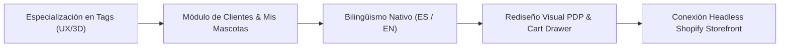
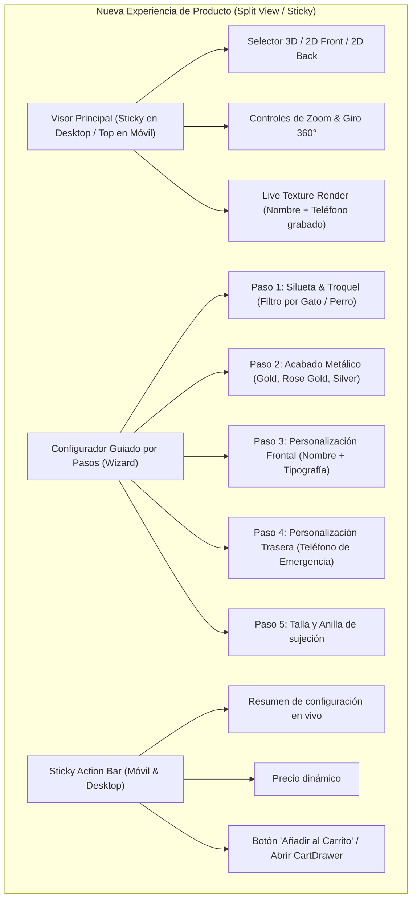
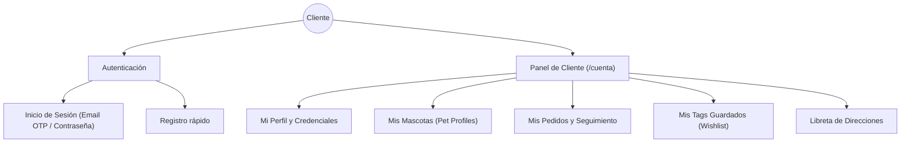
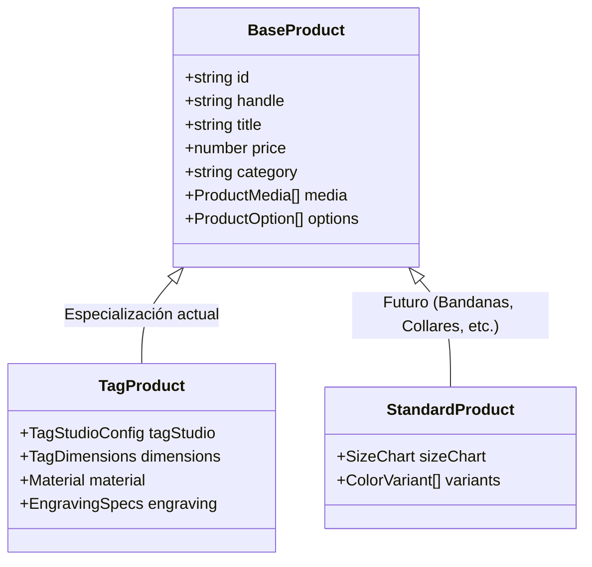
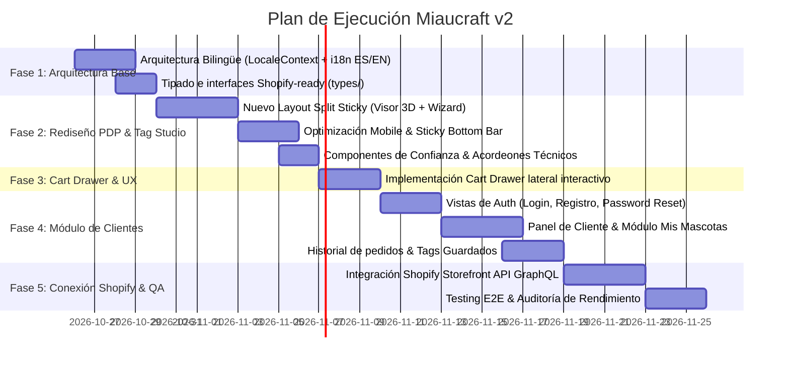

# Plan Maestro de Desarrollo: Miaucraft v2 (Especialización en Tags & Preparación Shopify)

Este documento establece la hoja de ruta integral para transformar **Miaucraft** en un e-commerce de referencia en accesorios personalizados para mascotas, enfocado inicialmente en su producto estrella (**Cat & Dog ID Tags**) y preparado estructuralmente para la conexión con **Shopify Storefront API**.

---

## 1. Visión Estratégica y Objetivos



### Objetivos Clave
1. **Especialización inicial en Tags:** Reorientar el catálogo, la home y el embudo de conversión para destacar las placas de identificación personalizables como producto insignia, sin comprometer la capacidad de agregar bandanas, collares y complementos en fases posteriores.
2. **Rediseño radical de la Ficha de Producto (PDP):** Resolver los problemas de usabilidad del configurador actual, unificando el visor 2D/3D con un flujo de personalización guiado por pasos (Wizard o Split Interactivo), sticky bar móvil y galería de prueba social (UGC).
3. **Módulo de Clientes ("Mi Cuenta" & "Mis Mascotas"):** Crear una experiencia de cliente de primer nivel (login, perfil, libreta de direcciones, historial de pedidos y un registro de mascotas para precargar nombres y teléfonos en los tags).
4. **Arquitectura Bilingüe (EN / ES):** Soporte nativo para alternar idioma y moneda, adoptando el estándar de rutas y diccionarios tipados de INHAND, enfocado en el mercado estadounidense (USD) y de habla hispana.
5. **Preparación Técnica para Shopify:** Diseñar los modelos de datos y el estado del carrito desacoplado para que la conexión a la Storefront API sea un cambio de adaptador transparente.

---

## 2. Rediseño de la Página de Producto (PDP)

### 2.1 Diagnóstico de Problemas Actuales
* **Scroll infinito:** El componente `TagStudio` se apila verticalmente en la columna derecha, forzando al usuario a desplazarse más de 1200px hacia abajo mientras el visor 3D queda fuera de la pantalla.
* **Cuadrícula de diseños sobrecargada:** Mostrar los 23 diseños en una grilla fija de 4 columnas abruma al usuario y dificulta la visualización de los detalles de troquelado.
* **Falta de sincronización táctil:** En móviles, interactuar con el lienzo 3D y cambiar de opciones genera conflictos de scroll y zoom accidental.
* **Jerarquía de decisión difusa:** El cliente debe elegir diseño, acabado, tipografía, nombre y teléfono al mismo tiempo sin un orden de pasos intuitivo.

### 2.2 Nueva Arquitectura de la Ficha de Producto



### 2.3 Especificaciones de Diseño
* **Layout Desktop (55% Visor / 45% Configuración):**
  - Columna izquierda fija (`sticky top-24`): el visor 3D se mantiene visible en todo momento mientras el usuario personaliza en la columna derecha.
  - Columna derecha con navegación por pestañas/pasos numerados:
    1. **Forma / Troquel:** Carrusel horizontal o grid colapsable con vista previa nítida del grabado.
    2. **Material / Color:** Swatches metálicos circulares con reflejo y textura realista.
    3. **Datos de Mascota:** Input de nombre con vista previa tipográfica inmediata (17 fuentes organizadas por estilo: *Clásico, Moderno, Juguetón, Elegante*).
    4. **Reverso:** Grabado de número telefónico de emergencia y micro-texto ("Microchipped", "Call Mom").
* **Layout Móvil:**
  - Visor anclado arriba (altura fija 320px) con botón flotante para alternar vista 3D / 2D y anverso / reverso.
  - Acordeón de personalización deslizante inferior.
  - **Bottom Sticky Bar:** Barra persistente con precio, botón de compra y resumen de opciones seleccionadas.
* **Bloques Complementarios:**
  - Acordeones interactivos de especificaciones (Dimensiones exactas en mm, Acero quirúrgico 316L, resistencia al agua y arañazos).
  - Guía visual interactiva de tallas según el peso/raza de la mascota.
  - Muro de reseñas con fotos reales (UGC) de mascotas luciendo el tag.

---

## 3. Módulo Completo de Clientes ("Mi Cuenta & Mascotas")

El módulo de clientes se estructurará pensando en la futura integración con **Shopify Customer Account API (New Customer Accounts / Multipass)**, pero ofreciendo una experiencia rica y personalizada desde el frontend.



### 3.1 Vistas y Funcionalidades del Módulo

| Vista / Sección | Ruta | Funcionalidades |
|---|---|---|
| **Acceso / Registro** | `/cuenta/login`, `/cuenta/registro` | Autenticación con email/contraseña y magic link (compatible con Shopify New Customer Accounts). Validación accesible y feedback visual. |
| **Dashboard Principal** | `/cuenta` | Resumen del último pedido, accesos directos a mascotas registradas y estado de envíos. |
| **Mis Mascotas (`PetProfiles`)** | `/cuenta/mascotas` | **Funcionalidad estrella:** Ficha de cada mascota (Nombre, Especie: Perro/Gato, Raza, Cumpleaños, Foto, Teléfono de emergencia). Permite personalizar un tag en 1 clic usando los datos guardados de la mascota. |
| **Historial de Pedidos** | `/cuenta/pedidos`, `/cuenta/pedidos/:id` | Listado de pedidos, desglose de líneas con la miniatura del tag personalizado tal como se compró, tracking del transportista y descarga de factura. |
| **Tags Guardados / Diseños** | `/cuenta/guardados` | Configuraciones de tags que el cliente personalizó en el `TagStudio` pero no compró inmediatamente, listas para enviar al carrito. |
| **Direcciones** | `/cuenta/direcciones` | Gestión de direcciones de envío y facturación habituales. |

---

## 4. Arquitectura de Internacionalización (Bilingüe ES / EN)

Siguiendo el estándar de **INHAND**, implementaremos una arquitectura bilingüe escalable basada en TypeScript y React Context:

```
src/
├── config/
│   ├── i18n/
│   │   ├── es.json         # Textos completos en español
│   │   ├── en.json         # Textos completos en inglés (Mercado USA)
│   │   └── index.ts        # Contrato tipado de claves (I18nDictionary)
│   └── routes.ts           # Mapeo canónico de rutas por idioma
├── context/
│   └── LocaleContext.tsx   # Idioma activo ('es' | 'en'), moneda ('USD' | 'EUR'), formateadores
└── hooks/
    └── useTranslation.ts   # Hook tipado con autocompletado de claves
```

### Directrices de Traducción
* **Español (ES):** Tono cálido, cercano y profesional.
* **Inglés (EN - Mercado USA):** Terminología e-commerce estándar en Norteamérica:
  - *Tag* (no placa), *Engraving* (grabado), *Split Ring* (anilla), *Surgical Stainless Steel* (acero quirúrgico inoxidable), *Free shipping over $50*, *14-day hassle-free returns*.
* **Conmutador de Idioma:** Selector elegante en el Header y Footer con bandera/código de idioma y sincronización automática en `localStorage` y atributo `lang` del documento HTML.

---

## 5. Estrategia de Catálogo: Especialización en Tags y Extensibilidad Futura

Para maximizar el impacto de lanzamiento sin cerrar la puerta a nuevas categorías:



1. **Jerarquía Actual:**
   - La navegación principal se enfocará en: **Cat Tags**, **Dog Tags**, **Ver Todos los Tags**, **Materiales & Acabados**, **Personalizador**.
   - Los productos de bandanas y collares se mantendrán archivados o en una sección secundaria de catálogo ("*Próximamente / Complementos*"), evitando dispersar la atención del comprador.
2. **Modelo de Datos Extensible:**
   - Cada producto cuenta con un campo polimórfico `productType: 'tag' | 'accessory' | 'apparel'`.
   - La página de producto renderiza condicionalmente el `TagStudio` si el producto es de tipo `'tag'`, o un selector clásico de tallas/colores si es de tipo estándar.

---

## 6. Preparación Técnica para la Conexión con Shopify Storefront API

Para que la transición de mock a producción real con Shopify sea inmediata, el frontend cumplirá con las siguientes interfaces estándar de Shopify:

### 6.1 Mapeo de Atributos Personalizados en el Carrito
Cuando un usuario añade un tag personalizado, se empaqueta en la estructura `CartLineInput` de Shopify:

```typescript
// Formato exacto requerido por Shopify Storefront GraphQL
const shopifyCartLine = {
  merchandiseId: "gid://shopify/ProductVariant/4458921029", // ID de variante según el acabado
  quantity: 1,
  attributes: [
    { key: "_DesignShape", value: "DSA066" },
    { key: "Color Finish", value: "Gold" },
    { key: "Pet Name", value: "Amber" },
    { key: "Font Style", value: "FT12" },
    { key: "Back Phone", value: "+1 (555) 234-5678" },
    { key: "_PreviewRenderUrl", value: "https://.../renders/preview-xyz.png" } // Opcional para fulfillment
  ]
};
```

### 6.2 Adaptador de Carrito Desacoplado
```
src/lib/cart/
├── CartContext.tsx         # Interfaz unificada del carrito
├── adapters/
│   ├── LocalCartAdapter.ts # Implementación actual (localStorage) para desarrollo y preview
│   └── ShopifyCartAdapter.ts # Implementación Storefront API (cartCreate, cartLinesAdd)
```

---

## 7. Fases y Plan de Ejecución Paso a Paso



### Detalle de Entregables por Fase

#### Fase 1: Cimientos Arquitectónicos & Bilingüismo (Días 1–5)
- [ ] Crear directorio `src/types/` con interfaces puras de `Product`, `TagStudio`, `Cart`, `Customer`, `Order`.
- [ ] Implementar `LocaleContext` con soporte para inglés (`en`) y español (`es`).
- [ ] Configurar diccionario tipado de traducción y selector de idioma en Header/Footer.
- [ ] Implementar el sistema de rutas limpias o con prefijo.

#### Fase 2: Rediseño Total de la Ficha de Producto (Días 6–13)
- [ ] Desacoplar el visor 3D/2D en un contenedor `sticky` de alta resolución con controles intuitivos.
- [ ] Transformar `TagStudio` en un Wizard guiado por pasos (Troquel → Color → Grabado Nombre → Grabado Teléfono).
- [ ] Implementar la barra flotante inferior en móviles (*Sticky Action Bar*) con resumen dinámico.
- [ ] Incorporar los acordeones técnicos inspirados en Vitablue (medidas en mm, resistencia al agua, cuidados).
- [ ] Optimizar la carga diferida (`React.lazy`) del visualizador 3D para maximizar el Core Web Vitals (LCP).

#### Fase 3: Cart Drawer y Experiencia de Compra (Días 14–17)
- [ ] Implementar el componente `CartDrawer` lateral accesible con `useScrollLock` (patrón INHAND).
- [ ] Mostrar en cada línea de producto la miniatura del tag con el nombre grabado y los atributos elegidos.
- [ ] Añadir cálculo de envío gratuito dinámico ("*Te faltan $15 para envío gratis*").

#### Fase 4: Módulo Integral de Clientes & Mascotas (Días 18–25)
- [ ] Desarrollar las vistas de `/cuenta/login`, `/cuenta/registro`.
- [ ] Construir la sección `/cuenta/mascotas` (*PetProfiles*): alta, edición y fotos de mascotas.
- [ ] Vincular el perfil de mascota con el `TagStudio` ("*Personalizar con los datos de Luna*").
- [ ] Crear la vista de `/cuenta/pedidos` con seguimiento y vista de tags adquiridos.
- [ ] Crear la vista de `/cuenta/guardados` para tags configurados pendientes de compra.

#### Fase 5: Conexión con Shopify Storefront API & Despliegue (Días 26–30)
- [ ] Configurar cliente GraphQL de Shopify con Storefront Access Token público.
- [ ] Reemplazar `LocalCartAdapter` por `ShopifyCartAdapter` con llamadas `cartCreate`, `cartLinesAdd`.
- [ ] Configurar la redirección transparente a la URL de checkout seguro de Shopify.
- [ ] Pruebas cruzadas en dispositivos móviles y lanzamiento en entorno staging.

---

Este plan unifica la agilidad del diseño de **INHAND**, la madurez del cascarón y accesibilidad de **Vitablue**, y explota al máximo el motor de personalización 3D único de **Miaucraft**.
